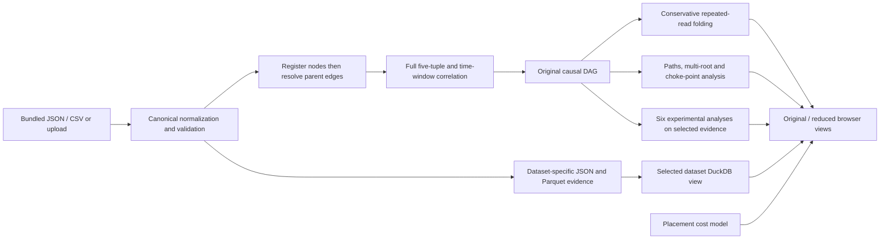
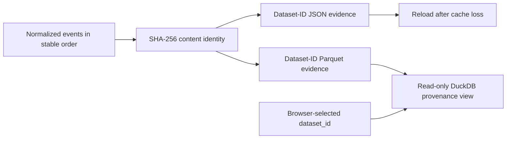

# CLOUD-M7: implemented Review 2 architecture

The prepared demo runs on one laptop. Edge, Fog and Cloud are event attributes describing a controlled scenario, not separate deployed computers. Node.js listens on loopback; browser CSS, JavaScript and Vis Network assets are local.

## Ingestion and causal validity

Canonical JSON events contain `uuid`, finite Unix-seconds `timestamp`, `tier`, `host_id`, `event_type`, `payload`, and `parents`. CSV uses `payload_json` and `parents_json`. An optional supplied `tamper_hash` is checked against the canonical SHA-256 digest; otherwise it is computed. UUIDs must be unique, parents must exist, and dependencies cannot travel backward in time or form cycles. Native parsing errors include row numbers. The bounded demo accepts at most 2,000 events and 5 MB uploads.

Batch ingestion registers every node before resolving parent UUIDs. Input order cannot silently remove parent edges. Socket correlation requires matching source IP/port, destination IP/port and protocol, different tiers, and a transit interval between zero and fifteen seconds. The resulting graph must be acyclic. Failed path lookup returns no path; chronological sorting never substitutes for causality.

## Reduction and evidence retention

Fold maximal consecutive file-read chains only when each member has one predecessor and successor, host/tier and complete payload match, and a process/PID and resource are present. Branch/merge nodes, network events and incident endpoints remain separate. Deterministic folded IDs map to ordered original UUIDs; the inspector exposes every full record.

The original DAG is authoritative for reconstruction and choke-point analysis. The reduced graph is a representation with verified source/sink reachability. Selecting paths and folding do not delete original evidence. No fixed reduction percentage is promised for arbitrary inputs.

## Storage and dataset identity

The demo buffers events in memory and persists local files under `data/processed/datasets`. It does not implement deployed edge SQLite, Kuzu, ClickHouse or Neptune; earlier database schemas remain design material. Completed files are published atomically by content ID. SQL requires that ID, registers its records as `provenance`, permits one SELECT, and disables external file access. There is no shared last-written dataset file.

## Interfaces

| Interface | Behaviour |
|---|---|
| `GET /api/health` | Runtime identity and configured Python path. |
| `GET /api/datasets` | Prepared controlled datasets. |
| `GET /api/analyze?dataset=...&force=true` | Analyse bundled alias or persisted content ID; force bypasses Node cache. |
| `POST /api/upload` | Multipart `dataset_file`; validate, analyse, persist, remove temporary upload. |
| `POST /api/sql` | JSON `query` and `dataset_id`; read-only results for that ID. |

Analysis preserves existing response fields and adds `dataset_id`, `dataset_provenance`, full `events`, `reduction`, `reduced_graph`, `folded_membership`, `folded_evidence`, and `placement`. The legacy `noise_reduction_pct` remains compatible; the UI describes exclusion from one selected path. SQL results clear on dataset changes; superseded responses are ignored.

`advanced_tracks` contains all six integrated experimental results. Each analysis runs once in `cloud_m7/advanced/analysis.py`, against the same original DAG and selected records. `advanced_tracks.processing_time_ms` measures the complete experimental calculation; top-level `processing_time_ms` includes the experimental results and placement construction, while excluding JSON serialization, process startup and HTTP/browser overhead. Experiments do not replace the authoritative graph, repeated-read reduction or dataset-scoped SQL. See [advanced integration](advanced_integration.md) for each track's actual guarantees and limitations.

## Interpretation

Processing times, graph counts and file sizes are measured. Placement latency, bandwidth, privacy, cost and capacity values are estimates. Attack labels are supplied ground truth, not predictions. Bridge and MITRE analyses are heuristic; remediation proposes commands. Docker, hardware, live eBPF and public-benchmark evaluation are later work. An unkeyed digest is not a signature or trusted log anchor.
